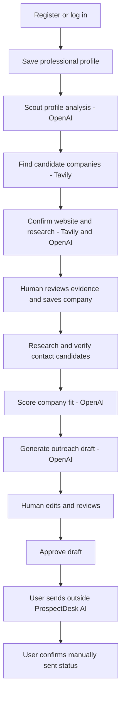
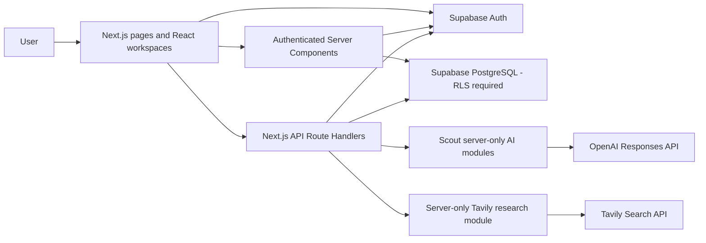
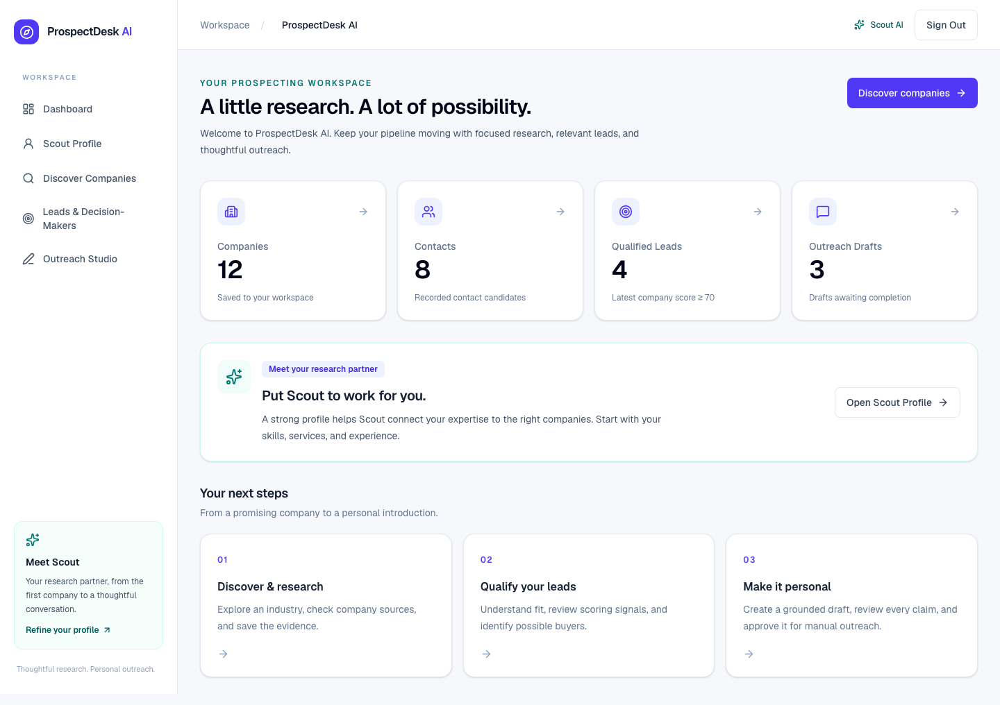
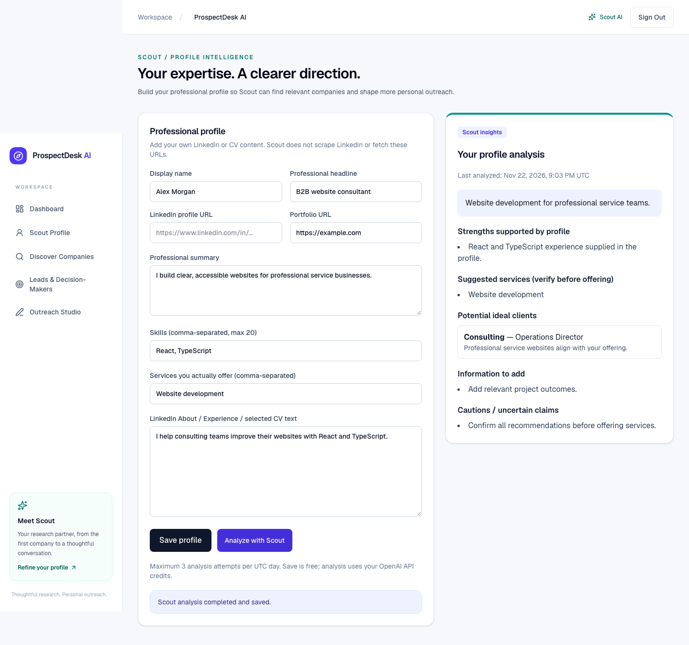
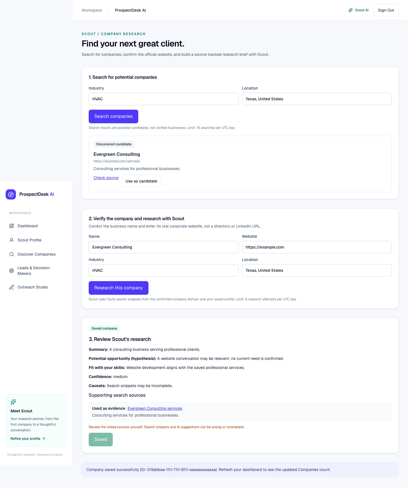
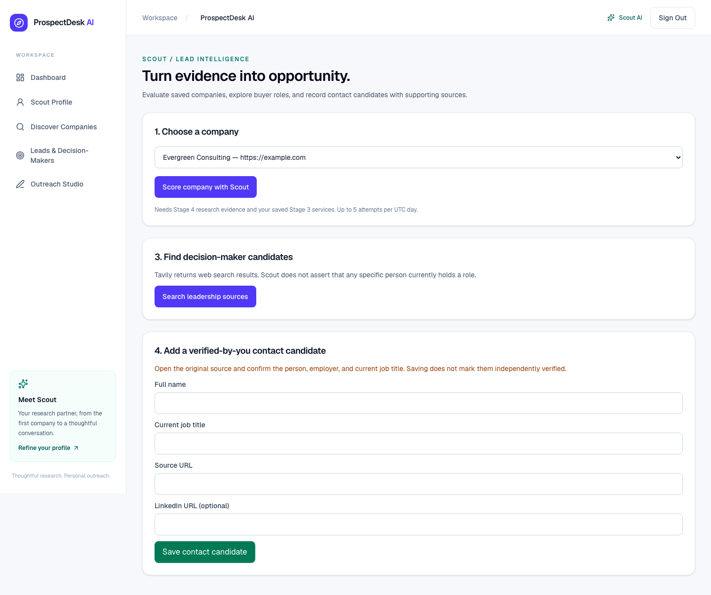
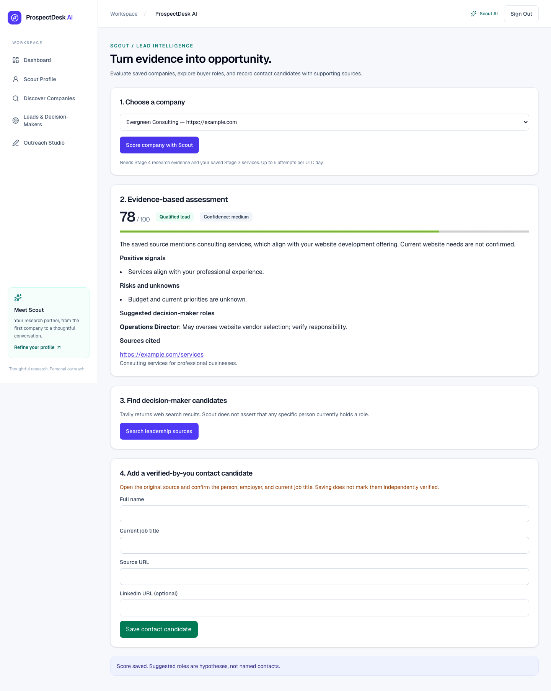
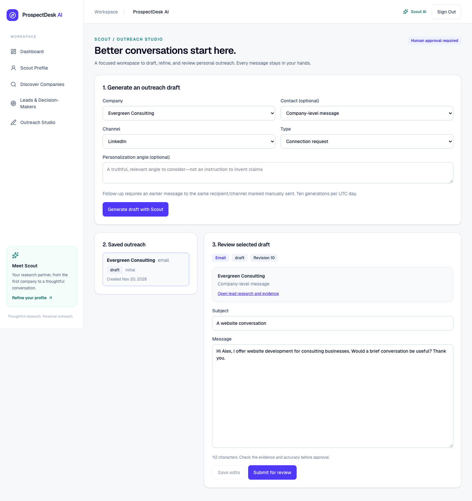

# ProspectDesk AI

**AI-Powered Prospect Discovery, Lead Intelligence & Personalized Outreach**

ProspectDesk AI is a B2B prospecting workspace for freelancers, agencies, consultants, and service providers. It brings professional positioning, company research, lead qualification, and outreach preparation into one workflow, reducing the manual work of deciding which businesses to approach and what to say.

**Scout**, the application's AI assistant, analyzes your supplied professional profile, interprets company research, scores potential fit, and prepares personalized LinkedIn and email drafts. You remain responsible for checking sources, verifying contacts, reviewing claims, and deciding whether to reach out.

**Messages are never sent by ProspectDesk AI.** Approval authorizes a draft for your manual use; it does not transmit an email or LinkedIn message.

> **Repository status:** The application code includes the Stage 1–6 workflows, Stage 7 security/testing additions with partial endpoint coverage, and a responsive UI modernization. Database migration files are missing from this checkout. A fresh Supabase project cannot be provisioned from this repository alone; see [Database setup](#database-setup). Stage 8 is not marked complete.

## Contents

- [Key features](#key-features)
- [How it works](#how-it-works)
- [Technology stack](#technology-stack)
- [System architecture](#system-architecture)
- [Project structure](#project-structure)
- [Installation and setup](#installation-and-setup)
- [Available scripts](#available-scripts)
- [Testing and quality assurance](#testing-and-quality-assurance)
- [Security](#security)
- [AI and third-party API costs](#ai-and-third-party-api-costs)
- [Screenshots](#screenshots)
- [Development stages](#development-stages)
- [Future improvements](#future-improvements)
- [License](#license)
- [Author](#author)

## Key features

### Authentication and user data

- Email/password registration, login, sign-out, and an email-confirmation callback through Supabase Auth.
- Server-side authentication checks for the dashboard and feature pages, with signed-out visitors redirected to `/login`.
- Authenticated API handlers and explicit user ownership filters for profile, company, contact, research, scoring, and draft operations.
- Supabase session refresh through the Next.js proxy and cookie-aware server/browser clients.
- A database design that **requires Supabase Row-Level Security**. A two-user integration test checks company isolation, but policy definitions are not included here and deployed RLS cannot be verified from source alone.

### Scout Profile Analyzer

- Manage your name, headline, summary, skills, offered services, LinkedIn/portfolio URLs, and supplied CV or profile text.
- Generate a positioning statement, profile-supported strengths, suggested services, potential client industries/buyer roles, missing information, and cautions.
- Save profile edits before analyzing; saving invalidates the previous analysis.
- Profile URLs are reference fields: Scout does not fetch them or scrape LinkedIn profiles.

### Company discovery and research

- Search by industry and location using Tavily.
- Review candidate results and confirm the company's official name and website before researching.
- Combine company-domain search snippets with your saved profile to generate a research summary, potential opportunity hypothesis, relevance explanation, confidence level, and caveats.
- Review supporting sources and save the cited evidence with the company.
- Detect an already-saved website using its normalized domain and handle duplicate-save responses.

### Decision-maker identification

- Search public leadership-related sources for a saved company through Tavily.
- Use Scout's qualification results to consider relevant **buyer roles**, rather than treating AI-generated names as verified contacts.
- Manually record a contact candidate's name, current job title, HTTPS source URL, and optional LinkedIn URL.
- Preserve the verification source while leaving `verified_at` unset. A saved source link is not independent verification of a person's employment or authority.

### AI lead scoring

- Evaluate saved research against the services in your professional profile.
- Produce a score from 0–100, confidence, reasoning, positive signals, risks, suggested buyer roles, and evidence citations.
- Use the existing scoring rubric: service match 40 points, relevant business need 30, industry/size suitability 20, and evidence quality 10.
- Display the existing qualification threshold of **70 or higher**, without presenting a high score as proof of purchase intent.

### Personalized Outreach Studio

- Generate LinkedIn connection requests, initial messages, and follow-ups, plus email initial/follow-up drafts with a subject.
- Personalize drafts using your real services, saved company research, an optional sourced contact, and a user-supplied angle.
- Edit and save drafts, submit them for review, approve or reject them, and return them to draft for revision.
- Lock approved/manually-sent content against editing through the API, and use revision checks to detect stale updates when the expected database revision behavior is installed.
- Copy approved messages for manual sending outside the application.
- Record `manually_sent` only after explicit confirmation. Follow-up generation requires an earlier manually-sent message for the same company, contact selection, and channel.

### Dashboard and interface

- Show Supabase-backed counts for saved companies, contact candidates, qualified leads, and drafts awaiting completion.
- Use the latest company score from the most recent 1,000 score rows when calculating qualified leads; count outreach drafts with `draft` or `in_review` status.
- Navigate through a shared desktop sidebar or a keyboard-accessible mobile dialog.
- Reuse Geist typography, Tailwind design tokens, status badges, alerts, loading skeletons, empty states, and responsive forms/editors.

### Security and reliability

- Zod request validation and structured AI output schemas.
- Database quota RPC calls before paid operations, provider timeouts, output limits, and disabled OpenAI SDK retries.
- Prompt instructions that treat profile text, source snippets, and personalization angles as untrusted data.
- A shared origin/content-type/body-size guard and hourly quota check **currently integrated into outreach generation**; other endpoints have varying local checks and daily quota calls.
- Offline validation/safety tests, signed-out browser/API smoke tests, synthetic UI workflow checks, and an opt-in live RLS test. See [Security](#security) for coverage limits.

## How it works

| Step | User journey | Scout or provider involvement |
| --- | --- | --- |
| 1 | Register or log in; confirm your email when required by Supabase. | Supabase Auth; no AI call. |
| 2 | Enter and save your professional profile and actual services. | Human input and a database write. |
| 3 | Run Scout's profile analysis and review its suggestions. | OpenAI generates structured profile insights. |
| 4 | Search for potential client companies by industry/location. | Tavily returns candidate search results. |
| 5 | Confirm the official website, research the business, review sources, and save it. | Tavily supplies company-domain snippets; OpenAI interprets them. |
| 6 | Search leadership sources and manually verify contact candidates. | Tavily supplies research leads; the user confirms names and roles. |
| 7 | Score company fit and inspect the reasoning and evidence. | OpenAI applies the qualification rubric to saved evidence. |
| 8 | Choose a company, optional contact, channel, and message type; generate a draft. | OpenAI prepares an evidence-informed message. |
| 9 | Check factual claims, edit the message, save, and submit for review. | Human review; editing does not send anything. |
| 10 | Approve the draft, copy it, and send it yourself in your chosen app. | Human approval and external manual sending. |
| 11 | Confirm manual sending and track the recorded draft status. | Database status update; no transmission by ProspectDesk AI. |

Scoring and contact research share the Qualification workspace and can be performed in either order after saving company research. Profile analysis is useful preparation; research and outreach read your saved profile and do not require an analysis result as a separate prerequisite.



### Outreach review states

| Current state | Allowed review actions | Result |
| --- | --- | --- |
| `draft` | Submit | `in_review` |
| `in_review` | Approve, reject, or return to draft | `approved`, `rejected`, or `draft` |
| `rejected` | Revise | `draft` |
| `approved` | Confirm that the exact message was manually sent | `manually_sent` |
| `manually_sent` | No further review transitions | Terminal state |

Editing a `draft`, `in_review`, or `rejected` message returns it to `draft`. Approved and manually-sent messages cannot be edited through the draft API.

## Technology stack

Versions below come from `package.json` and the resolved `package-lock.json`, rather than assumptions about the latest releases.

| Category | Technology and declared version | Purpose |
| --- | --- | --- |
| Frontend | Next.js `16.4.6`; React / React DOM `19.3.0` | App Router, server-rendered authenticated pages, interactive workspaces, and Suspense. |
| Languages | TypeScript `^5` (locked to `5.9.3`); JavaScript; CSS | Application types, components, utility/test scripts, and global styles. PostgreSQL SQL functions run in the external database; SQL definitions are absent here. |
| Styling | Tailwind CSS / `@tailwindcss/turbopack` `4.3.3` | Utility styles, shared theme tokens, and the existing CSS loader. |
| Icons and fonts | Lucide React `^1.77.0`; Geist via `next/font` | Interface iconography and typography. |
| Backend | Next.js Route Handlers and Server Actions | Authenticated API operations and sign-out. |
| Database | Supabase PostgreSQL; `@supabase/supabase-js` `^2.119.2` | User data, research, scoring, drafts, and quota/save RPC calls. The database server version is not specified. |
| Authentication | Supabase Auth; `@supabase/ssr` `^0.12.7` | Email/password sessions, cookies, and server/browser clients. |
| AI | OpenAI SDK `^7.62.0` | Responses API with Zod-based Structured Outputs. Default configured model: `gpt-4o-mini`. |
| Search and research | Tavily Search API via native `fetch` | Industry/location search and company/leadership research. No Tavily SDK dependency is installed. |
| Validation | Zod `^4.6.7` | Input schemas, provider response checks, and AI output contracts. |
| Testing | Vitest `^4.1.12`; Playwright `^1.65.1` | Offline unit/evaluation tests, browser/API smoke tests, and synthetic UI checks. |
| Developer tooling | ESLint `^9`; `eslint-config-next` `16.4.6`; `tsx` `^4.23.15` | Linting and TypeScript script tooling. |
| Server boundaries | `server-only` `^0.0.1` | Prevent accidental client imports of AI and research modules. |

The lockfile resolves the listed caret dependencies to the versions shown without the caret, except TypeScript and ESLint, whose declarations specify broader major-version ranges. Use the lockfile for exact transitive dependency versions.

## System architecture

Next.js Server Components authenticate users and load initial Supabase data. Client workspaces call same-origin Route Handlers for profile changes, research, scoring, and outreach actions. The browser uses the Supabase publishable key for authentication; OpenAI and Tavily credentials stay in server-only modules.



- **Session layer:** `src/proxy.ts` refreshes/checks session claims through Supabase. Protected pages and API handlers separately call `auth.getUser()`; the proxy alone is not the route-authorization boundary.
- **Data layer:** explicit owner filters and database RLS are complementary requirements. Supabase RPCs handle quota claims and company/evidence saving.
- **Scout layer:** four server-only modules cover profile analysis, company research, qualification, and outreach. They return structured results, not autonomous background actions.
- **Research layer:** Tavily returns bounded HTTPS search results. Company research uses up to five company-domain sources; Scout is instructed that it has snippets rather than a direct website inspection.
- **Rendering:** `next.config.ts` enables Cache Components and partial prefetching. User-specific pages retain `connection()` and Suspense boundaries. Read `AGENTS.md` and the installed Next.js guides before changing framework behavior.

### API surface

All data endpoints below authenticate the caller. This is an overview, not a replacement for the request schemas in `src/lib/validations/`.

| Method | Path | Purpose |
| --- | --- | --- |
| GET, POST | `/api/companies` | List owned companies or create a basic company record; the POST does not perform research. |
| POST | `/api/profile` | Save profile fields and invalidate old analysis. |
| POST | `/api/profile/analyze` | Analyze the saved profile; accepts no JSON body. |
| POST | `/api/discover/search` | Search for candidate companies. |
| POST | `/api/discover/research` | Research a confirmed company website against your profile. |
| POST | `/api/discover/save` | Save a reviewed company/research/evidence payload. |
| POST | `/api/qualification/score` | Score an owned, researched company. |
| POST | `/api/qualification/decision-makers` | Search leadership-related web sources. |
| POST | `/api/qualification/contacts` | Save a manually sourced contact candidate. |
| POST | `/api/outreach/generate` | Generate and save a draft after eligibility/quota checks. |
| GET | `/api/outreach/drafts` | List up to 100 owned drafts. |
| PATCH | `/api/outreach/drafts/{id}` | Edit a draft or request an allowed status transition. |

The authentication callback is `GET /auth/confirm?token_hash=...&type=email`. There is no message-sending endpoint.

## Project structure

```text
prospectdesk-ai/
├── AGENTS.md                          # Agent guidance and installed Next.js documentation rule
├── README.md
├── package.json
├── package-lock.json
├── next.config.ts                     # Cache Components, partial prefetching, Tailwind loader
├── tsconfig.json                      # Strict TypeScript and @/* source alias
├── eslint.config.mjs
├── playwright.stage7.config.ts         # Existing browser-test configuration
├── public/                            # Static assets
├── src/
│   ├── proxy.ts                       # Supabase session refresh entry point
│   ├── app/
│   │   ├── layout.tsx                 # Metadata, Geist fonts, global styles
│   │   ├── globals.css                # Tailwind tokens and shared interface styles
│   │   ├── page.tsx                   # Authenticated dashboard queries
│   │   ├── login/page.tsx              # Login/signup
│   │   ├── profile/page.tsx
│   │   ├── discover/page.tsx
│   │   ├── qualification/page.tsx
│   │   ├── outreach/page.tsx
│   │   ├── actions/auth.ts             # Sign-out Server Action
│   │   ├── auth/confirm/route.ts        # Email confirmation callback
│   │   └── api/                        # Companies, profile, discovery, qualification, outreach
│   ├── components/
│   │   ├── dashboard/overview.tsx
│   │   ├── layout/                    # App shell and sign-out control
│   │   ├── ui/primitives.tsx           # Brand, badges, headings, alerts, empty/loading states
│   │   ├── profile/profile-editor.tsx
│   │   ├── discover/discover-workspace.tsx
│   │   ├── qualification/workspace.tsx
│   │   └── outreach/studio.tsx
│   └── lib/
│       ├── ai/                        # Scout profile, research, qualification, outreach modules
│       ├── research/tavily.ts          # Search provider integration
│       ├── security/                  # Request guard, bounded JSON reader, smoke evaluator
│       ├── supabase/                  # Browser, server, and proxy clients
│       └── validations/               # Zod schemas and colocated unit tests
├── tests/
│   ├── unit/                          # Bounded JSON reader tests
│   ├── evals/                         # Offline output-contract and safety smoke tests
│   ├── integration/                   # Opt-in two-user Supabase RLS test
│   ├── e2e/                           # Signed-out API/auth and responsive login checks
│   └── fixtures/ui-preview.tsx         # Synthetic feature-workspace fixture
├── scripts/
│   ├── verify-ui.mjs                   # Local mocked browser workflows and screenshots
│   └── run-live-evals.ts               # Optional live-evaluation runner; see known limitation
├── artifacts/ui/                      # Existing screenshots and fixture result summary
└── docs/ui-modernization.md            # Design-system and UI verification report
```

There is no `supabase/migrations/` directory, `supabase/config.toml`, or `.env.example` in this checkout. Generated build output and dependencies are omitted from the tree.

## Installation and setup

### Prerequisites

- **Node.js 22.12+ on the 22.x line, or Node.js 24+**, and npm. This satisfies the installed Next.js, OpenAI, Vitest, and Vite engine constraints; the project does not currently pin a Node version.
- Git.
- A Supabase project containing the required schema, functions, policies, and workflow triggers described below.
- An OpenAI API key with access to the configured Responses API model for Scout's AI actions.
- A Tavily API key for company search, company research, and leadership-source searches.
- Chromium installed through Playwright when running browser tests.

### Clone and install

```bash
git clone https://github.com/jisan3s/prospectdesk-ai.git
cd prospectdesk-ai
npm install
```

For a reproducible clean installation using the checked-in lockfile, `npm ci` is an alternative to `npm install`.

### Environment variables

Create `.env.local` in the project root with your own values:

```dotenv
NEXT_PUBLIC_SUPABASE_URL=https://your-project.supabase.co
NEXT_PUBLIC_SUPABASE_PUBLISHABLE_KEY=your-supabase-publishable-key
OPENAI_API_KEY=your-openai-api-key
TAVILY_API_KEY=your-tavily-api-key

# Optional; this is the current fallback in the AI modules.
OPENAI_MODEL=gpt-4o-mini
```

| Variable | Required for | Exposure |
| --- | --- | --- |
| `NEXT_PUBLIC_SUPABASE_URL` | Auth, protected pages, and database access | Public project URL. |
| `NEXT_PUBLIC_SUPABASE_PUBLISHABLE_KEY` | Browser/server Supabase clients | Intentionally public publishable key; RLS must protect data. |
| `OPENAI_API_KEY` | Profile analysis, company analysis, qualification, and outreach generation | Server-only secret. |
| `TAVILY_API_KEY` | Company and leadership-source searches | Server-only secret. |
| `OPENAI_MODEL` | Optional model override | Server configuration; defaults to `gpt-4o-mini`. Choose a model supporting the response format used by the code. |

The code uses **`NEXT_PUBLIC_SUPABASE_PUBLISHABLE_KEY`**, not `NEXT_PUBLIC_SUPABASE_ANON_KEY`. No service-role key is required by the application or test setup.

Next.js loads `.env.local` for the application. Standalone test/scripts do not automatically receive all Next.js environment files; export the needed variables explicitly as described in [Testing](#testing-and-quality-assurance).

An example environment file is not supplied. A useful follow-up is a sanitized `.env.example` containing only these placeholders. The current `.gitignore` ignores every `.env*` file, so committing such a template would also require an explicit ignore exception. Keep actual credentials out of Git.

### Database setup

**The repository is not yet self-contained for database provisioning.** The previous README referred to a Stage 7 SQL migration that does not exist in this checkout. No Supabase CLI project configuration is supplied, so there is no verified migration command to run here.

For an existing database, confirm its schema/version with the maintainer before applying any SQL. For a new project:

1. Obtain the authoritative Stage 2–7 schema/migrations, including policies, grants, indexes, quota functions, and workflow triggers.
2. Back up any existing database and review migration history. Do not blindly rerun historical scripts or infer a production schema from frontend field names.
3. Apply the reviewed scripts to a separate development Supabase project first, in their intended order, using the project's established database workflow or Supabase SQL Editor.
4. Verify RLS and authenticated-user grants on every user-data table. Check that the quota RPCs scope usage to the authenticated user.
5. Verify the company-save RPC and outreach triggers, including revision increments and approval/sent timestamps, before exercising those workflows.
6. Run the dedicated two-user RLS test and authenticated smoke checks before using real prospect data.

The application references these tables; this inventory is **not** a complete schema specification:

| Table | Referenced purpose / ownership field |
| --- | --- |
| `profiles` | Professional data and Scout analysis; `user_id`. |
| `companies` | Saved businesses, normalized `website_host`, research summaries; `owner_id`. |
| `research_sources` | Company-linked source URLs, titles, and findings; `owner_id`. |
| `contacts` | Company-linked contact candidates and verification sources; `owner_id`. |
| `lead_scores` | Company scores, explanations, confidence, and evidence; `owner_id`. |
| `outreach_drafts` | Message content, channel, review state, revisions, timestamps, generation context; `owner_id`. |
| `agent_runs` | Profile/research/scoring task execution records; `owner_id`. |

Required RPCs referenced in source:

| RPC | Arguments used by the application | Purpose |
| --- | --- | --- |
| `claim_profile_analysis_quota` | None | Profile-analysis daily quota. |
| `claim_discovery_usage` | `p_action`: `search` or `research` | Discovery/research daily quotas. |
| `save_discovered_company` | `p_name`, `p_website`, `p_industry`, `p_location`, `p_summary`, `p_sources` | Save reviewed company research and evidence. |
| `claim_qualification_usage` | `p_action`: `score` or `roles` | Scoring and leadership-search quotas. |
| `claim_outreach_generation` | None | Outreach daily quota. |
| `claim_api_hourly_limit` | `p_action`: `outreach_generate` in the integrated route | Stage 7 hourly safeguard. |

The precise SQL definitions, hourly ceiling, underlying quota tables, and deployed RLS/trigger behavior cannot be established from the checked-in files.

### Authentication configuration

Enable email/password signup in your Supabase project and configure the local site URL (`http://localhost:3000`) plus the intended deployment URLs in its authentication settings.

If email confirmation is enabled, configure the confirmation email link to match the implemented callback shape:

```text
{{ .SiteURL }}/auth/confirm?token_hash={{ .TokenHash }}&type=email
```

The callback verifies an email OTP token hash and redirects to the dashboard on success. The signup UI does not provide its own `emailRedirectTo`; confirm your Supabase email template and URL settings together rather than assuming the defaults match this handler.

### Run locally

After configuring the environment and development database:

```bash
npm run dev
```

Open [http://localhost:3000](http://localhost:3000). Signed-out visitors are redirected to `/login`; use its account-creation control to register.

To run a production build locally:

```bash
npm run build
npm run start
```

Keep the existing Cache Components configuration when troubleshooting. `AGENTS.md` directs framework changes to the documentation bundled with the installed Next.js package. Production builds use `next/font/google` for Geist, so an uncached build may need network access for font assets.

## Available scripts

These are the four npm scripts defined in `package.json`:

| Command | Purpose |
| --- | --- |
| `npm run dev` | Start the Next.js development server. |
| `npm run build` | Create the production build. |
| `npm run start` | Serve a previously built application. |
| `npm run lint` | Run ESLint. |

There is no npm `test` or `typecheck` script. Use the direct commands below instead of `npm run test`.

## Testing and quality assurance

### Local static and offline checks

```bash
npm run lint
npx tsc --noEmit
RUN_RLS_TESTS=0 npx vitest run --exclude 'tests/e2e/**'
```

The Vitest command excludes Playwright files and explicitly disables the live RLS suite. It covers:

- Profile, company/discovery, contact/qualification, and outreach input/output schemas.
- URL normalization and same-domain source matching.
- Score normalization and valid evidence indexes.
- Outreach channel lengths, required revisions, and rejection of extra ownership fields in strict schemas.
- Bounded JSON reader behavior, including oversized and invalid payloads.
- Deterministic output-contract and forbidden-phrase regression tests on synthetic adversarial cases.

These tests make no OpenAI or Tavily calls. They do not prove factual accuracy, comprehensive prompt-injection resistance, or production database isolation.

### Browser and signed-out API checks

Install the test browser once:

```bash
npx playwright install chromium
```

Start the application in one terminal with `npm run dev`, or `npm run start` after a build. In another terminal:

```bash
npx playwright test --config=playwright.stage7.config.ts
```

The configuration targets `http://localhost:3000`; it does not start a web server for you. Existing tests cover protected-page redirects, signed-out rejection for discovery/outreach generation, and login/signup labels and layout at 375, 768, 1024, and 1440 pixels. They do not authenticate real users or exercise every API route.

### Mocked feature workflows and screenshots

With a **local development server** running on port 3000:

```bash
node scripts/verify-ui.mjs
```

This script temporarily mounts `tests/fixtures/ui-preview.tsx` as a local preview page, intercepts `/api/` calls with synthetic responses, and checks profile save/analyze, discovery/research/save, duplicate and rate-limit feedback, retry/pending states, scoring, contact capture, and draft editing/review/manual-send transitions. It also checks layout overflow and mobile dialog focus behavior at the four viewport sizes.

Results and screenshots are written under `artifacts/ui/`. The script refuses to overwrite an existing preview directory and removes its temporary route on normal completion or caught failure. Run it only locally with a development server, not against a deployed application. These checks validate UI behavior under mocks; they do not prove that quota RPCs, provider failures, database policies, or live writes behave correctly.

### Live RLS isolation test

Use a **separate non-production Supabase project**, the authoritative schema, and two distinct confirmed test accounts. Do not use a service-role key.

Create an ignored `.env.stage7.test.local` with placeholders replaced by your own test values:

```dotenv
TEST_SUPABASE_URL=https://your-test-project.supabase.co
TEST_SUPABASE_PUBLISHABLE_KEY=your-test-publishable-key
TEST_USER_A_EMAIL=test-user-a@example.com
TEST_USER_A_PASSWORD=replace-with-test-password-a
TEST_USER_B_EMAIL=test-user-b@example.com
TEST_USER_B_PASSWORD=replace-with-test-password-b
RUN_RLS_TESTS=1
```

In a shell, load that trusted local file and run:

```bash
set -a
source .env.stage7.test.local
set +a
npx vitest run tests/integration/rls.integration.test.ts
```

The suite creates one synthetic company for user A, checks that B cannot read/update/delete it or forge its owner, and attempts cleanup of that exact record. It skips unless `RUN_RLS_TESTS=1` and refuses `NODE_ENV=production`. You must still verify that the test URL is non-production; the test cannot identify a production project by its URL. Other user-data tables need separate isolation checks.

### Live AI evaluation: current limitation

`scripts/run-live-evals.ts` contains a two-case synthetic OpenAI evaluation gated by `RUN_LIVE_EVALS=1` and `OPENAI_API_KEY`. It uses the same optional `OPENAI_MODEL` override.

The existing direct `tsx` execution path has a module-mode problem: the script uses top-level `await`, while the root package has no ESM declaration, causing a CommonJS transform error. Fix or establish an ESM-compatible invocation before treating this as a runnable evaluation command. No live evaluation is part of the default tests, and this documentation task does not change the runner. Any eventual live run consumes OpenAI credits and remains a small smoke evaluation, not a safety certification.

### Coverage still requiring manual or integration checks

- Authenticated end-to-end profile, research, scoring, and outreach persistence.
- Actual hourly/daily quota enforcement, concurrency, and 429 behavior in Supabase.
- RLS and write permissions for all tables, including direct client attempts to alter approved content.
- Real OpenAI/Tavily outage, timeout, invalid-credential, and quota-exhaustion handling.
- Broader adversarial model evaluation and human review of source coverage, factual claims, and outreach tone.

## Security

### Implemented controls

- **Authentication and ownership:** protected pages and data APIs verify the user through Supabase; records are selected/changed using explicit ownership filters. User IDs for writes are assigned from the authenticated session rather than trusted from form input.
- **Server credentials:** OpenAI and Tavily modules use `server-only`; secret provider keys have no `NEXT_PUBLIC_` prefix.
- **Request validation:** Zod validates feature payloads and AI structures. Most feature writes reject a mismatched supplied `Origin`. Coverage varies; the basic company-creation API does not use the shared origin/body guard.
- **Outreach request hardening:** `/api/outreach/generate` applies origin and JSON content-type checks, a declared-size precheck, and a streaming 16,000-byte JSON reader. It authenticates before quota RPC calls.
- **Usage safeguards:** expensive operations call their daily quota RPCs before provider requests. Outreach generation additionally calls `claim_api_hourly_limit`; the other five costly actions do not currently call that shared hourly helper.
- **Provider limits:** OpenAI calls disable SDK retries, have 25–30 second timeouts, and bound output tokens. Tavily uses a 12-second timeout, basic search, no raw content/images/answer, and at most eight results, with bounded returned fields.
- **AI handling:** prompts explicitly separate untrusted source/profile material from instructions and prohibit fabricated credentials, people, relationships, and business claims. Responses are parsed into Zod schemas; research citations are range-checked. These are defenses and validation, not guarantees of truth.
- **Human review:** the draft API checks allowed transitions, rejects edits to approved/sent drafts, and requires an explicit `confirmedManualSend` flag for the sent-state update.

### Limits and database requirements

RLS policies, quota implementation details, and expected database workflow triggers are not available in this checkout. Application ownership filters do not replace RLS for clients using the public Supabase key. Verify the deployed policies, revision increments, immutable fields, timestamp behavior, and RPC grants independently.

The Stage 7 shared body/hourly guard is only integrated into outreach generation. Other handlers use local validation and, in several cases, unrestricted `request.json()` reads. Do not describe the shared 16,000-byte ceiling or hourly safeguard as application-wide protections.

The research-save endpoint accepts a user-supplied research snapshot after schema/domain/evidence checks. A signed-in user can modify their own submitted research; it is not an immutable record of a provider response. Audit-grade attribution would need server-owned snapshots and stricter provenance controls.

There is no demonstrated deployment-wide per-IP limiter or full production security audit in the repository. Test account abuse, concurrent quota claims, and direct database access before using real client data. Establish appropriate data retention, prospect deletion, opt-out handling, and privacy practices for your use case.

### Protect configuration

- Keep `.env.local`, test credentials, and all real API keys out of Git; `.env*` is currently ignored.
- Use only the publishable Supabase key in public configuration. Never place a service-role key, OpenAI key, or Tavily key in a browser-exposed variable.
- Use a secrets manager or hosting environment settings for deployed secrets, and rotate any credential accidentally exposed.
- Avoid logging raw profile text, prospect data, tokens, or provider request payloads.

## AI and third-party API costs

OpenAI actions can consume paid API credits. Tavily searches can consume provider credits or paid usage depending on your plan and limits. Prices, model availability, and provider limits can change; check your accounts before running real research or evaluations. No fixed provider pricing is assumed here.

The route-level daily limits/messages currently indicate:

| Action | Limit expressed by the application | Providers |
| --- | --- | --- |
| Profile analysis | 3 attempts per UTC day | OpenAI |
| Company search | 15 searches per UTC day | Tavily |
| Company research | 5 attempts per UTC day | Tavily + OpenAI |
| Lead scoring | 5 attempts; application UI presents a UTC-day limit | OpenAI |
| Leadership-source search | 5 searches; route identifies this as a daily limit | Tavily |
| Outreach generation | 10 attempts per UTC day, plus the integrated hourly quota RPC | OpenAI |

The deployed RPCs are authoritative for enforcement; their SQL is missing, so exact reset behavior and the hourly threshold cannot be audited here. Quota claims happen before provider calls, and a failed attempt can still consume a claimed allowance or provider credits. Timeouts and output limits reduce exposure but are not a billing cap.

Profile saving and draft editing/review do not call OpenAI or Tavily. Use offline tests and the mocked UI script for routine checks, and set provider-side budgets appropriate to your account.

## Screenshots

These are existing screenshots of the implemented interface. **Dashboard and feature screenshots use synthetic test data from the local UI verification script; the application itself reads Supabase data.** The screenshots do not demonstrate a live integration run.

### Dashboard



### Scout Profile Analyzer



### Company discovery and research



### Decision-maker identification

The existing Qualification page combines lead scoring, leadership-source research, and manual contact capture. This screenshot shows that workspace; there is no separate decision-maker page or dedicated populated-contact screenshot.



### Lead scoring



### Outreach Studio



Mobile examples: [Dashboard](artifacts/ui/dashboard-375.png), [Profile analysis](artifacts/ui/profile-analysis-375.png), [Company research](artifacts/ui/discovery-research-375.png), [Qualification](artifacts/ui/qualification-score-375.png), and [Outreach Studio](artifacts/ui/outreach-375.png).

The [UI modernization report](docs/ui-modernization.md) documents the design system and its recorded checks. This README's source audit clarifies safeguard integration and database-file gaps; that report is not evidence that missing policies or migrations exist.

## Development stages

This mapping describes functionality visible in the current source, rather than certifying an external database or deployment.

| Stage | Scope | Repository evidence / status |
| --- | --- | --- |
| 1 — Project Setup and Foundation | Next.js, React, TypeScript, Tailwind, application foundation. | Present in dependencies, configuration, routes, and UI. |
| 2 — Database and Authentication | Supabase clients, email/password authentication, protected pages, owned data access. | Application integration present; schema, migrations, and RLS definitions missing. |
| 3 — Scout AI Profile Analyzer | Profile editing, persistence, structured AI analysis. | Profile page/API, validation, and Scout module present; requires database/RPC setup. |
| 4 — Company Research and Discovery | Tavily search, company-domain research, evidence saving, duplicate handling. | Discovery workspace/routes and research module present; save/quota RPC definitions missing. |
| 5 — Decision-Maker Identification and Lead Scoring | Leadership-source search, contact candidates, evidence-based company scores. | Qualification workspace, schemas, routes, and AI rubric present. |
| 6 — Personalized Outreach Studio | Draft generation/editing, review, approval/rejection, manual-send tracking, follow-ups. | Studio, generator, and transition API present; expected database triggers require verification. |
| 7 — Security Hardening and Testing | Request guard, quotas, bounded JSON helper, offline/e2e/RLS tests, evaluation tooling. | Additions present; shared guard integrated only into outreach generation, live eval runner has a module-mode limitation, and live coverage remains opt-in. |
| UI modernization | Shared responsive shell, design tokens, feature layouts, loading/error states, screenshot checks. | Implemented across existing pages; details in `docs/ui-modernization.md`. |
| 8 | Further development. | Not documented as completed in this repository. |

## Future improvements

The following are proposed follow-ups, not implemented features or release commitments:

- Restore authoritative, version-controlled database migrations and Supabase setup configuration, including all RLS policies, quotas, and outreach workflow triggers.
- Add a sanitized environment template and pin a supported Node runtime.
- Extend and test consistent request-size/hourly safeguards across the remaining costly endpoints; review edge/account abuse controls.
- Fix the live-evaluation runner's module mode and broaden authenticated, cross-table RLS, concurrency, and provider-failure tests.
- Store immutable server-owned research snapshots where stronger provenance is needed.
- Expose safe saved research/personalization context and last-updated information in Outreach, and improve draft searching and unsaved-edit navigation feedback.
- Add privacy-aware operational monitoring, retention/deletion workflows, and a broader accessibility review.

Automatic sending, mailbox connections, CRM synchronization, and autonomous campaigns are not implemented or promised by this roadmap.

## License

No project license file or license declaration is present in the repository. Licensing has not yet been specified; do not assume an MIT or other open-source license applies. Dependency licenses do not establish the license of this application.

## Author

**Jisan — Full-Stack Web Developer**

[GitHub](https://github.com/jisan3s) · [Project repository](https://github.com/jisan3s/prospectdesk-ai)
